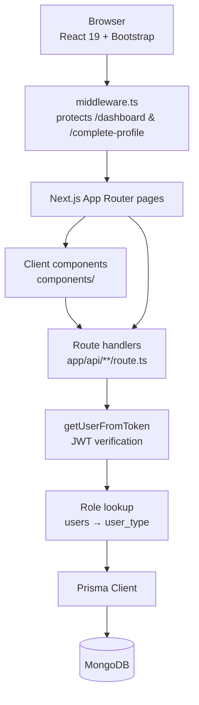
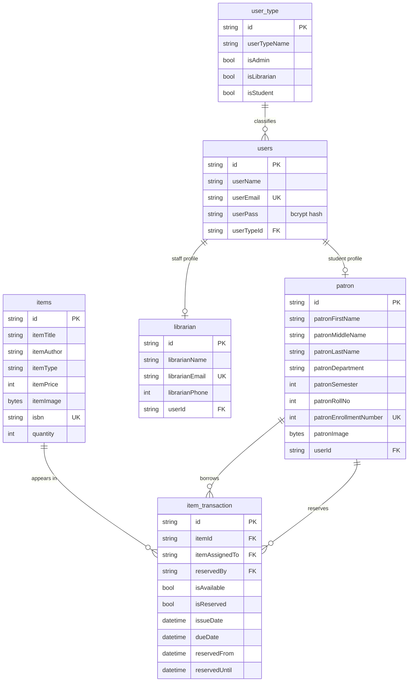

# LibraryHub

**A role-based library management system for City Central Library, built with Next.js 15, Prisma, and MongoDB.**

LibraryHub gives students a self-service catalogue — browse, borrow, reserve, and track due dates — while giving librarians and admins a back office for inventory, members, and circulation. Authentication uses bcrypt-hashed passwords and short-lived JWTs stored in `httpOnly` cookies, and borrowing and returning use database transactions to keep stock and loan records consistent.


---

## Table of Contents

- [Overview](#overview)
- [Features](#features)
- [Product tour](#product-tour)
- [Tech stack](#tech-stack)
- [Architecture](#architecture)
- [Data model](#data-model)
- [Project structure](#project-structure)
- [Getting started](#getting-started)
- [Available scripts](#available-scripts)
- [Troubleshooting](#troubleshooting)
- [API reference](#api-reference)
- [Business rules](#business-rules)
- [Security notes](#security-notes)
- [Roadmap and known limitations](#roadmap-and-known-limitations)
- [Contributing](#contributing)
- [License](#license)
- [Acknowledgements](#acknowledgements)

---

## Overview

LibraryHub models a real library workflow: a user account belongs to a role (`student`, `librarian`, or `admin`), students get a patron profile, and every book movement is recorded as an `item_transaction` — either a loan or a reservation. Staff can add and edit the catalogue, activate reservations, and process returns, while admins also manage members and staff records. Students get their own view of the catalogue and their borrowing history.

The project is a full-stack Next.js application. Pages and layouts live under the App Router, API endpoints are implemented as route handlers under `app/api`, and Prisma provides type-safe access to MongoDB.

## Features

### Students

- **Sign up and sign in** with email or username and a bcrypt-hashed password.
- **Complete a library profile** with name, department, semester, roll number, enrollment number, and an optional photo.
- **Browse and search the catalogue**, filter by category, and see live availability.
- **Borrow instantly** when a copy is in stock — up to five active loans, each due in 14 days.
- **Reserve a book** with a pickup date when you want to hold it — one active reservation at a time, held for 48 hours.
- **Track borrowed books and due dates** in the borrowing view and profile.
- **View library stats** — books read, currently borrowed, overdue, and borrowing history.

### Librarians

- **Dashboard overview** with total books, active members, books issued, and monthly circulation charts.
- **Catalogue management** — add, edit, and delete books with title, author, type, ISBN, price, quantity, and cover image.
- **Circulation desk** — review all loans, reservations, and returns; activate reservations; mark books as returned.
- **Role-aware navigation** — staff and students see different dashboards and content.

### Admins

- Everything librarians can do, plus:
- **Member directory** with search by name, roll number, enrollment number, or department.
- **Member administration** — view detailed patron records and delete members who have no active loans.
- **Staff administration** — create and manage librarian records, and list all user accounts (API-level; no dedicated staff screen yet).
- **Reporting access** — the admin-only reports area (currently a placeholder).

### Feature matrix

| Capability | Student | Librarian | Admin |
| :--- | :---: | :---: | :---: |
| Browse and search the catalogue | ✅ | ✅ | ✅ |
| Borrow books | ✅ | — | — |
| Reserve books | ✅ | — | — |
| Manage the catalogue | — | ✅ | ✅ |
| View the member directory | — | — | ✅ |
| Activate reservations and process returns | — | ✅ | ✅ |
| Delete members | — | — | ✅ |
| Create and manage librarian records | — | — | ✅ |
| Reports and analytics | — | — | ✅ (placeholder) |

## Product tour

| Route | What you will find |
| :--- | :--- |
| `/` | Public landing page with library hours, location, library-card info, and new arrivals |
| `/login` | Combined sign-in / sign-up experience |
| `/complete-profile` | Student onboarding form with profile photo upload |
| `/dashboard` | Role-aware workspace: staff analytics and management, catalogue and circulation views for everyone, and personal borrowing for students |
| `/profile` | Student library profile with membership details, stats, and borrowed books |

## Tech stack

| Layer | Technology | Notes |
| :--- | :--- | :--- |
| Framework | [Next.js 15.3](https://nextjs.org) (App Router) | Server and client components, route handlers, Turbopack in development |
| UI | [React 19](https://react.dev) | Client-side state and data fetching |
| Language | [TypeScript 5](https://www.typescriptlang.org) | End-to-end typing with Prisma-generated types |
| Styling | [Bootstrap 5.3](https://getbootstrap.com) + CSS Modules | Responsive layout, custom component styles |
| Icons | Bootstrap Icons, Font Awesome, [Lucide React](https://lucide.dev) | Mixed icon sets across the UI |
| Charts | [Recharts](https://recharts.org) and [Chart.js](https://www.chartjs.org) via `react-chartjs-2` | Monthly issues chart; chart scaffolding for reports |
| ORM | [Prisma 6](https://www.prisma.io) | Generated client in `app/generated/prisma` |
| Database | [MongoDB](https://www.mongodb.com/atlas) | Document model with ObjectId relations |
| Auth | `jsonwebtoken`, `bcrypt`, `cookie` | JWT in an `httpOnly` cookie; bcrypt password hashing |
| Dates | `react-datepicker` | Reservation pickup date selection |

## Architecture



### Request flow

1. **Page navigation.** `middleware.ts` checks for a `token` cookie (presence only) on `/dashboard` and `/complete-profile`. Missing tokens are redirected to `/login`.
2. **Authentication.** `POST /api/auth/login` loads the user with their role flags, compares the password with bcrypt, signs a 1-hour JWT, and sets it as an `httpOnly`, `SameSite=Lax` cookie.
3. **Authorization.** API routes call `getUserFromToken()` and then load `user_type` from the database before allowing admin, librarian, or student actions. The token's role is a convenience; sensitive routes re-check the database.
4. **Data access.** Prisma models map to MongoDB collections. Borrowing and returning run inside `prisma.$transaction()` so stock changes and transaction records commit together.
5. **Rendering.** Pages fetch from the API with `credentials: "include"`, then render role-specific components — staff analytics or student borrowing views.

### Design decisions

- **One transaction collection for loans and reservations.** The `item_transaction` model uses boolean state (`isReserved`, `isAvailable`) plus optional dates to represent the entire lifecycle without extra tables.
- **Stock is explicit.** `items.quantity` is the source of truth for availability; borrowing and returning adjust it atomically alongside the transaction record.
- **History is preserved.** Returns mark transactions as available rather than deleting them, so borrowing history and reporting stay intact.
- **Defence in depth.** Middleware gates pages, and sensitive API routes independently verify the token and role.

## Data model



| Model | Purpose |
| :--- | :--- |
| `users` | Login identity: username, unique email, hashed password, and role reference |
| `user_type` | Role flags — an account can be an admin, librarian, and/or student |
| `patron` | Student member profile linked one-to-one with a user |
| `librarian` | Staff profile linked one-to-one with a user |
| `items` | Catalogue entries with inventory count, ISBN, price, and optional cover image |
| `item_transaction` | Loans and reservations, including issue/due dates and hold windows |

> The canonical schema lives in [`prisma/schema.prisma`](prisma/schema.prisma).

## Project structure

```text
LibraryHub/
├─ app/
│  ├─ api/
│  │  ├─ auth/                  # signup, login, logout, me, change-password
│  │  ├─ dashboard/             # aggregate stats for staff dashboard
│  │  ├─ items/                 # catalogue CRUD (+ [id] routes)
│  │  ├─ item-transactions/     # loans, reservations, returns, activation
│  │  ├─ librarians/            # staff records (admin only)
│  │  ├─ patron/                # student member profiles
│  │  ├─ profile/               # signed-in user's profile + stats
│  │  └─ users/                 # admin user listing
│  ├─ complete-profile/         # student onboarding flow
│  ├─ dashboard/                # role-aware dashboard shell
│  ├─ lib/getUserFromToken.ts   # shared JWT verification helper
│  ├─ login/                    # sign-in / sign-up page
│  ├─ profile/                  # student profile page
│  ├─ layout.tsx                # fonts, Bootstrap, Font Awesome
│  └─ page.tsx                  # public landing page
├─ components/
│  ├─ dashboard/                # staff dashboard, sidebar, books, members, transactions
│  ├─ user/                     # student dashboard, borrowing, profile
│  ├─ types/Types.tsx           # shared API/UI types
│  ├─ BookPopUp.tsx             # add/edit book modal
│  └─ EditProfilePopup.tsx      # member edit modal
├─ prisma/
│  ├─ schema.prisma             # MongoDB schema
│  └─ Schema.txt / Schema1.txt  # earlier schema notes
├─ public/                      # static assets
├─ middleware.ts                # cookie-based page protection
├─ next.config.ts
└─ package.json
```

> `app/generated/prisma` is generated by Prisma and ignored by Git — run `npx prisma generate` after cloning.

## Getting started

### Prerequisites

- **Node.js 18.18+** (Node 20 LTS recommended)
- **npm 9+** (the repository includes a `package-lock.json`)
- **MongoDB 6+** — [MongoDB Atlas](https://www.mongodb.com/atlas) is the easiest option and provides the replica set required by Prisma transactions
- **Git**

### 1. Clone and install

```bash
git clone <your-repository-url> libraryhub
cd libraryhub
npm install
```

### 2. Configure environment variables

Create a `.env` file in the project root:

```env
DATABASE_URL="mongodb+srv://<username>:<password>@<cluster>.mongodb.net/libraryhub?retryWrites=true&w=majority"
JWT_SECRET="replace-with-a-long-random-secret"
```

| Variable | Required | Description |
| :--- | :---: | :--- |
| `DATABASE_URL` | ✅ | MongoDB connection string, including the database name |
| `JWT_SECRET` | ✅ | Secret used to sign and verify authentication tokens |

Generate a strong secret with:

```bash
node -e "console.log(require('crypto').randomBytes(48).toString('base64'))"
```

`.env*` files are ignored by Git, so credentials will not be committed.

### 3. Generate the Prisma client and sync the schema

```bash
npx prisma generate
npx prisma db push
```

- `prisma generate` creates the typed client in `app/generated/prisma`.
- `prisma db push` applies the schema to MongoDB. MongoDB does not use SQL migrations, so `prisma migrate dev` is not supported — use `db push` instead.
- Optional: `npx prisma studio` opens a browser UI for inspecting and editing data.

### 4. Create the base user types

The login page's sign-up form assigns new accounts a default **student** `userTypeId` (`688527b160ff9a18b84ecdb4`). Create that record, plus librarian and admin types, before registering users. With `mongosh` connected to your database:

```js
// use your database name
use libraryhub

db.user_type.insertMany([
  {
    _id: ObjectId("688527b160ff9a18b84ecdb4"),
    userTypeName: "Student",
    isAdmin: false,
    isLibrarian: false,
    isStudent: true
  },
  {
    userTypeName: "Librarian",
    isAdmin: false,
    isLibrarian: true,
    isStudent: false
  },
  {
    userTypeName: "Admin",
    isAdmin: true,
    isLibrarian: false,
    isStudent: false
  }
])
```

> If you change the default student type ID, update `userTypeId` in `app/login/page.tsx` to match.

#### Bootstrap an admin account

Sign-up only creates student accounts. To create your first staff account, run a one-off script from the project root (after `prisma generate`):

```js
// create-admin.js — run once with: node create-admin.js
require("dotenv").config();
const { PrismaClient } = require("./app/generated/prisma");
const bcrypt = require("bcrypt");

const prisma = new PrismaClient();

(async () => {
  const adminType = await prisma.user_type.findFirst({
    where: { isAdmin: true },
  });

  if (!adminType) {
    throw new Error("No admin user_type found. Create the user types first.");
  }

  const userPass = await bcrypt.hash("ChangeMe123!", 10);

  await prisma.users.create({
    data: {
      userName: "admin",
      userEmail: "admin@example.com",
      userPass,
      userTypeId: adminType.id,
    },
  });

  console.log("Admin created. Sign in and change the password.");
})()
  .catch(console.error)
  .finally(() => prisma.$disconnect());
```

Replace the placeholder email and password before running, then delete the script. Librarian accounts follow the same pattern with a librarian `user_type`, plus a librarian record created through `POST /api/librarians/create` (an admin API with no dedicated UI screen yet).

### 5. Start the development server

```bash
npm run dev
```

Open [http://localhost:3000](http://localhost:3000). Sign up as a student to complete the onboarding flow, or sign in with the admin account you created.

### Deployment

The app is ready to deploy to [Vercel](https://vercel.com/new) or any Node.js host:

1. Push the repository to GitHub/GitLab/Bitbucket and import it into Vercel.
2. Add `DATABASE_URL` and `JWT_SECRET` in **Project Settings → Environment Variables**.
3. Allow your host's network in MongoDB Atlas (or use a restricted IP allowlist).
4. Ensure `prisma generate` runs during the build. If your host skips `postinstall` scripts, set the build command to `npx prisma generate && next build`.

Authentication cookies are automatically marked `Secure` when `NODE_ENV=production`, so production must be served over HTTPS.

## Available scripts

| Command | Description |
| :--- | :--- |
| `npm run dev` | Start the development server with Turbopack on port 3000 |
| `npm run build` | Create an optimized production build |
| `npm run start` | Serve the production build |
| `npm run lint` | Run Next.js lint checks |
| `npx prisma generate` | Regenerate the Prisma client after schema changes |
| `npx prisma db push` | Push schema changes to MongoDB |
| `npx prisma studio` | Open Prisma's database browser |

## Troubleshooting

| Symptom | Likely cause | Fix |
| :--- | :--- | :--- |
| `Cannot find module '@/app/generated/prisma'` | Prisma client has not been generated | Run `npx prisma generate` |
| `PrismaClientInitializationError` or connection timeouts | Wrong `DATABASE_URL`, or the database host is not allowed | Check the connection string, URL-encode special characters in the password, and allow your IP in MongoDB Atlas |
| `Transaction numbers are only allowed on a replica set member or mongos` | A standalone local `mongod` cannot run Prisma transactions | Use MongoDB Atlas, or start a local replica set and run `rs.initiate()` |
| Sign-up returns `500` | The default student `user_type` is missing | Insert the user types from [step 4](#4-create-the-base-user-types) |
| Login succeeds but the app redirects back to `/login` | Cookie blocked, expired, or signed with a different secret | Clear cookies, confirm `JWT_SECRET` is unchanged, and sign in again |
| A student keeps landing on `/complete-profile` | No patron profile exists for the account | Complete the form and check for unique roll/enrollment conflicts |
| `npm run build` fails on the host with missing Prisma client | Build host skipped `postinstall` | Add `npx prisma generate` before `next build` |

## API reference

All API routes live under `/api`. Protected routes read the `token` cookie and enforce role checks; the Access column summarizes the intended role for each endpoint.

### Authentication

| Method | Endpoint | Description | Access |
| :--- | :--- | :--- | :--- |
| `POST` | `/api/auth/signup` | Register a student account | Public |
| `POST` | `/api/auth/login` | Verify credentials, set the JWT cookie, and return a redirect target | Public |
| `POST` | `/api/auth/logout` | Clear the authentication cookie | Authenticated |
| `GET` | `/api/auth/me` | Return the decoded token payload | Authenticated |
| `POST` | `/api/auth/change-password` | Change the password using the current password | Authenticated |

### Catalogue

| Method | Endpoint | Description | Access |
| :--- | :--- | :--- | :--- |
| `GET` | `/api/items` | List all catalogue items | Public |
| `POST` | `/api/items` | Create an item (`multipart/form-data` with optional `itemImage`) | Admin / Librarian |
| `GET` | `/api/items/[id]` | Fetch one item | Public |
| `PUT` | `/api/items/[id]` | Update an item (`multipart/form-data`) | Admin / Librarian |
| `DELETE` | `/api/items/[id]` | Delete an item that has no active loans | Admin / Librarian |

### Circulation

| Method | Endpoint | Description | Access |
| :--- | :--- | :--- | :--- |
| `GET` | `/api/item-transactions` | Staff see all transactions; students see their own loans and reservations | Authenticated |
| `POST` | `/api/item-transactions` | Borrow an item (enforces stock and the 5-book limit) | Student |
| `GET` | `/api/item-transactions/[id]` | Fetch a single transaction | Admin / Librarian |
| `PUT` | `/api/item-transactions/[id]` | Update transaction fields | Admin / Librarian |
| `DELETE` | `/api/item-transactions/[id]` | Cancel/delete a transaction | Owner, Admin, or Librarian |
| `POST` | `/api/item-transactions/reserve` | Reserve an item for a pickup date | Student |
| `PUT` | `/api/item-transactions/[id]/activate` | Convert a reservation into a loan | Admin / Librarian |
| `PUT` | `/api/item-transactions/[id]/return` | Mark a loan as returned and restore stock | Admin / Librarian |

### Members and staff

| Method | Endpoint | Description | Access |
| :--- | :--- | :--- | :--- |
| `POST` | `/api/patron/create` | Create the signed-in student's patron profile | Authenticated |
| `GET` | `/api/patron/get-all` | List student patrons with active borrow counts | Admin / Librarian |
| `GET` | `/api/patron/[id]` | Fetch a patron profile with transactions | Admin / Librarian / Self |
| `PUT` | `/api/patron/[id]` | Update allowed patron fields | Admin / Librarian / Self |
| `DELETE` | `/api/patron/[id]` | Delete a patron and their user account | Admin |
| `POST` | `/api/librarians/create` | Create a librarian record | Admin |
| `GET` | `/api/librarians/get-all` | List librarian records | Admin |
| `GET` | `/api/librarians/[id]` | Fetch a librarian record | Admin |
| `PUT` | `/api/librarians/[id]` | Update a librarian record | Admin |
| `DELETE` | `/api/librarians/[id]` | Delete a librarian record | Admin |
| `GET` | `/api/users` | List all user accounts | Admin |

### Profile and dashboard

| Method | Endpoint | Description | Access |
| :--- | :--- | :--- | :--- |
| `GET` | `/api/profile` | Role-specific profile with student stats and borrowed books | Authenticated |
| `GET` | `/api/dashboard` | Totals, monthly issue data, and recent activity | Public (consumed by the staff dashboard) |

## Business rules

These rules are enforced in the API layer and backed by database constraints where applicable — not just in the UI:

- **Borrow limit:** a student can have at most **5 active loans** (`itemAssignedTo` set and `isAvailable: false`).
- **Loan period:** new loans are issued for **14 days**; `dueDate` is set automatically.
- **Stock control:** borrowing decrements `items.quantity`; returning increments it. Both happen inside a transaction with the circulation record.
- **Reservation limit:** a student can hold **one active reservation** at a time.
- **Reservation window:** reservations default to a **48-hour hold** (`reservedUntil`).
- **Reservation activation:** staff can convert a reservation to a loan, provided the book is in stock and the patron has not reached the 5-book limit. Activation assigns the book to the patron, clears the active reservation flags, and decrements stock.
- **Returns:** marked through the dedicated return endpoint, which restores stock and clears the due date.
- **Deletion guards:** books and patrons with active loans cannot be deleted.
- **Role routing:** students without a patron profile are redirected to `/complete-profile` after login; everyone else goes to `/dashboard`.

## Security notes

- Passwords are stored as **bcrypt** hashes (10 rounds).
- JWTs expire after **1 hour** and are stored in `httpOnly` cookies with `SameSite=Lax`; the cookie is `Secure` in production.
- Role checks query the database on protected routes, so a stale or tampered role claim is not trusted.
- `.env*` files are excluded from version control.
- Before a public production launch, consider adding:
  - Rate limiting on login, signup, and password-change endpoints
  - Schema validation (for example, Zod) for all request bodies
  - CSRF protection if cookie policies change
  - Object storage (S3, Cloudinary) for book covers and profile photos instead of MongoDB binary fields

## Roadmap and known limitations

| Area | Current state | Suggested next step |
| :--- | :--- | :--- |
| Student dashboard stats | Cards use placeholder data | Wire the component to `/api/profile`, which already returns live stats |
| Reports & Analytics | Placeholder screen, admin-only | Add circulation trends, popular titles, and overdue reports |
| Settings | Placeholder screen | Add library policies, loan periods, and fine configuration |
| Overdue count | `/api/dashboard` returns `overdue: 0` | Derive the count from transactions where `dueDate < now` and `isAvailable: false` |
| Automated tests | No test suite yet | Add unit tests for circulation rules and Playwright flows for login and borrowing |
| API pagination | Catalogue and member endpoints return all records | Add server-side search, filtering, and pagination |
| Notifications | Bell UI exists; no backend or email delivery | Add due-date reminders and reservation notifications |
| Prisma client | A new `PrismaClient` is created per module | Reuse a singleton to avoid extra connections during development |
| User listing | `GET /api/users` returns full user records, including password hashes | Restrict the query to safe fields before exposing it to clients |
| Staff management UI | Librarian and user administration is API-only | Add admin screens for creating and editing staff |
| Image storage | Covers and avatars are stored as MongoDB binary data | Move to object storage and store URLs |
| Reservation activation | Updates the transaction and stock in separate writes | Wrap activation in a `$transaction` like borrow and return |
| Input validation | Basic required-field checks | Adopt schema validation and consistent error shapes |

## Contributing

1. Fork the repository and create a feature branch:

   ```bash
   git checkout -b feature/your-feature
   ```

2. Keep changes focused and consistent with the existing structure (`app/api` for endpoints, `components/` for UI).
3. Run the app and verify the affected flows. Add or update tests when a test suite is introduced.
4. Commit with a clear message and open a pull request describing the change and how it was verified.

Bug reports and feature suggestions are welcome via GitHub issues. Please include steps to reproduce and any relevant API responses or console errors.

## License

No license file is included in this repository. If you plan to distribute or publish the project, add a `LICENSE` file (for example, MIT) and update this section.

## Acknowledgements

- [Next.js](https://nextjs.org) and [React](https://react.dev) for the application foundation
- [Prisma](https://www.prisma.io) and [MongoDB](https://www.mongodb.com) for the data layer
- [Bootstrap](https://getbootstrap.com), [Lucide](https://lucide.dev), and [Font Awesome](https://fontawesome.com) for the UI
- [Recharts](https://recharts.org) and [Chart.js](https://www.chartjs.org) for visualizations
- The open-source community behind the libraries used in this project
